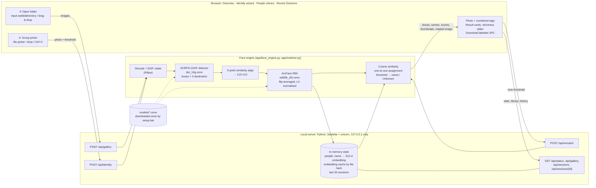

# Architecture

## Diagram

<!-- ARCHIFY: replace this block with the Archify export once generated:  -->
> The Archify diagram is being generated (`docs/architecture.png` and the interactive `docs/architecture.html`). The diagram below shows the same architecture.

## How a request flows

1. **Open folder.** The browser sends every image file in the folder to `/api/gallery`. For each file:
   - decode it and apply the EXIF rotation;
   - detect the face (taking the largest if there are several, and retrying with padding for tight headshots);
   - align it and compute a 512-number ArcFace embedding;
   - take the person's name from the file name.

   Embeddings are cached by the file's SHA-1, so reloading the same folder is instant. Problem files come back as warnings.
2. **Upload group photo.** `/api/identify`:
   - detects all faces, at a detector resolution of 640, 960 or 1280 depending on photo size, so small back-row faces aren't lost;
   - numbers them in reading order;
   - embeds each face, then matches the faces against the folder.
3. **Match** (`matcher.py`):
   - build the cosine similarity matrix (faces × people);
   - assign greedily from the highest similarity down, giving each person at most one face;
   - mark anything below the threshold as **Unknown**, but keep its closest name as a "Might be X?" hint.
4. **Render.** The server returns the rotated image, the boxes, names, scores and face thumbnails. The browser draws the tags with collision avoidance and the result cards.
5. **Strictness slider.** `/api/rematch` re-runs only step 3 on the stored embeddings, so the result updates instantly without detecting faces again.
6. **Sessions and stats.** Each analysed photo is kept in memory as a session (image, faces, embeddings). The Overview counts and Recent Sessions page read these through `/api/status` and `/api/sessions`. Nothing is written to disk, so history is cleared when the app closes.

Nothing leaves `127.0.0.1`. The server binds to localhost only, and the UI loads no external resources (the font is bundled).

## Trade-offs

| Chose | Gave up | Why |
|---|---|---|
| **SCRFD + ArcFace** (InsightFace `buffalo_l`) | A small install (OpenCV SFace is about 40 MB vs about 190 MB); a commercial-friendly licence | Accuracy on small and angled faces in real group photos matters most for the demo. A commercial version would swap in a permissively licensed model. |
| **Run the ONNX models directly** with onnxruntime | The `insightface` package's ready-made helpers (I re-implemented SCRFD decoding and alignment, about 150 lines) | The package needs a C++ compiler on Windows; onnxruntime is a plain wheel. |
| **CPU only** | GPU speed | Works on any laptop with no CUDA setup. About 1–1.5 s per group photo and about 8–10 s for a 50-person folder is fine for this use. |
| **Local web app** (Starlette + plain HTML/JS) | A native desktop window; a modern front-end framework | No build step, one command, a polished UI, and the browser's built-in folder picker. |
| **Plain JS sidebar app instead of React/Vite/Tailwind** for the redesign | Component tooling, hot reload | Node.js isn't installed on the demo laptop, and a build step adds risk. Hash routing and small render functions keep it to three files. |
| **Session history in memory only** | History surviving a restart | Photos of people shouldn't be written to disk by default; privacy over convenience. |
| **Starlette instead of FastAPI** | FastAPI's automatic validation and docs | Windows Smart App Control blocked FastAPI's compiled `pydantic_core` on the demo laptop. Starlette is pure Python. |
| **One photo per person** (multiple same-named photos are averaged) | Better accuracy from several photos per person | The brief gives one photo per person. Averaging still helps when more photos exist. |
| **Fixed default threshold (0.35) plus a live slider** | A fully automatic per-photo threshold | Unseen data varies. A visible, adjustable setting is more honest and fixable live in the demo. |
| **One-to-one name assignment** | The ability to show the same person twice (mirrors, edited photos) | Prevents look-alikes getting the same name, which is the more common error. |
| **In-memory state, single user** | Multi-user use; remembering the folder after a restart | It's a local single-user tool. Re-opening a folder takes about 10 s and is instant if the files are unchanged. |
| **Practice data from LFW collages** | Realism (collages are easier than real group photos) | Gives exact ground truth to measure and tune against. A real-photo check is listed below. |

## Known limitations

- **Tested mainly on LFW collages, not real group photos.** Real photos have smaller faces, motion blur and uneven lighting, so scores will be lower than the 0.6–0.8 seen in testing. If known people show as Unknown at the demo, move the slider towards *Relaxed*.
- **Profile (side-on) faces, sunglasses and masks** reduce accuracy. Very small faces are flagged as "Small face · less reliable".
- **Folder photos with several people:** the largest face is used and a warning is shown.
- **File names like `Priya Sharma (2).jpg`** are treated as a separate person named "Priya Sharma (2)".
- **The pretrained models are for non-commercial research use only.**
